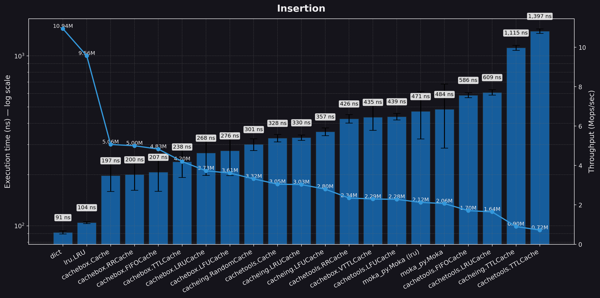
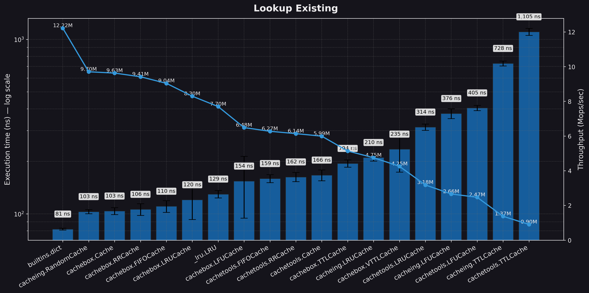
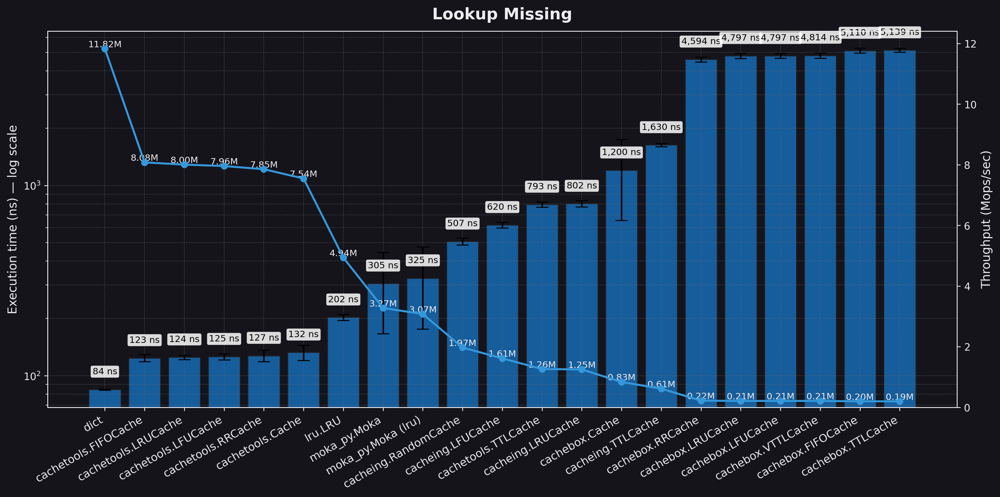
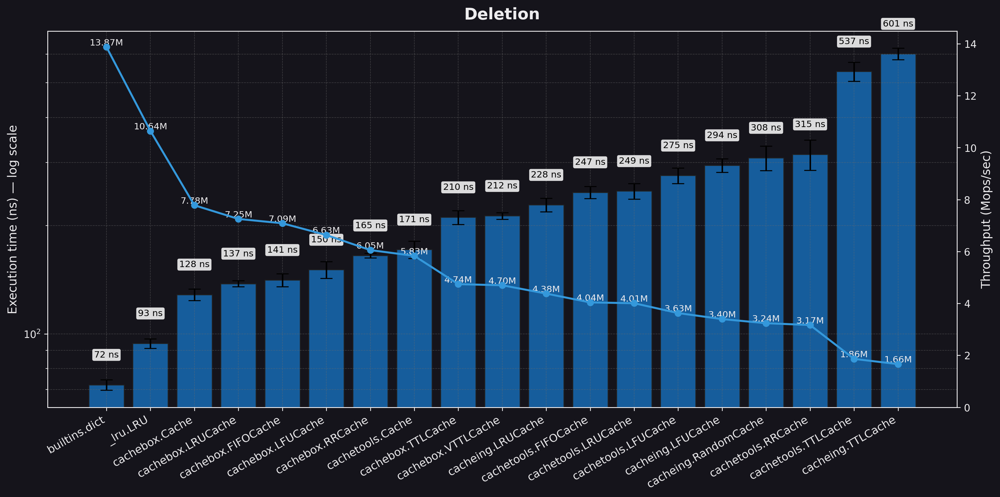
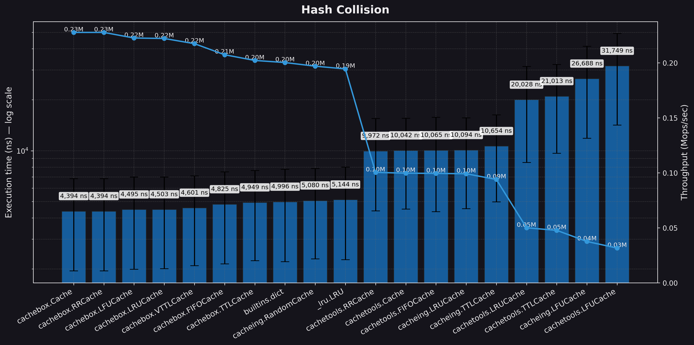

# Caching libraries Benchmarks


According to my new library [cachebox](https://github.com/awolverp/cachebox), I decided to benchmark caching libraries
which are I know, to show the power of [cachebox](https://github.com/awolverp/cachebox) ...

If you know other library, tell me to add it to this page.

> [!NOTE]\
> The `cacheing.VTTLCache` class was excluded from the benchmark because of numerous unreasonable errors.


## 🖥️ System Information
- **Platform**: Linux-6.15.11-2-MANJARO-x86_64-with-glibc2.42
- **Python**: 3.13.7
- **Processor**: 
- **Libraries**:
  - cachebox: 5.0.2
  - cachetools: 6.2.0
  - cacheing: 0.1.1
  - lru-dict: 1.3.0

## 📊 Insertion




- **Performance Range**: 15.3x difference between fastest and slowest
- **Best**: dict (91ns, 10.9M ops/sec)


|Implementation|Mean (ns)|Std Dev (ns)|Ops/sec|Samples|Stability|
| :---: | :---: | :---: | :---: | :---: | :---: |
|dict|91|2|10.9M|93|2.1%|
|lru.LRU|105|1|9.6M|90|1.4%|
|cachebox.Cache|198|38|5.1M|943|19.4%|
|cachebox.RRCache|200|38|5.0M|939|19.0%|
|cachebox.FIFOCache|207|48|4.8M|926|23.0%|
|cachebox.TTLCache|238|46|4.2M|925|19.2%|
|cachebox.LRUCache|268|71|3.7M|940|26.3%|
|cachebox.LFUCache|277|79|3.6M|946|28.7%|
|cacheing.RandomCache|301|24|3.3M|880|7.9%|🔴 B (Good)|
|cachetools.Cache|328|16|3.0M|907|5.0%|
|cacheing.LRUCache|330|12|3.0M|893|3.6%|
|cacheing.LFUCache|358|19|2.8M|860|5.2%|🔴 B (Good)|
|cachetools.RRCache|427|24|2.3M|879|5.7%|🔴 B (Good)|
|cachebox.VTTLCache|436|71|2.3M|940|16.4%|
|cachetools.LFUCache|439|19|2.3M|870|4.4%|
|moka_py.Moka (lru)|471|147|2.1M|941|31.1%|
|moka_py.Moka|485|198|2.1M|838|40.9%|
|cachetools.FIFOCache|587|20|1.7M|867|3.4%|
|cachetools.LRUCache|609|22|1.6M|890|3.6%|
|cacheing.TTLCache|1,115|37|0.9M|864|3.3%|
|cachetools.TTLCache|1,398|41|0.7M|872|3.0%|

## 📊 Lookup Existing




- **Performance Range**: 13.5x difference between fastest and slowest
- **Best**: dict (81ns, 12.4M ops/sec)


|Implementation|Mean (ns)|Std Dev (ns)|Ops/sec|Samples|Stability|
| :---: | :---: | :---: | :---: | :---: | :---: |
|dict|81|1|12.4M|97|1.0%|
|cachebox.RRCache|104|4|9.6M|792|3.5%|
|cacheing.RandomCache|108|9|9.3M|901|8.0%|🔴 B (Good)|
|cachebox.Cache|110|9|9.1M|937|8.6%|🔴 B (Good)|
|cachebox.FIFOCache|114|9|8.8M|936|8.1%|🔴 B (Good)|
|cachebox.LRUCache|118|20|8.5M|822|17.3%|
|lru.LRU|133|7|7.5M|789|5.1%|🔴 B (Good)|
|cachebox.LFUCache|152|57|6.6M|956|37.5%|
|cachetools.FIFOCache|153|4|6.6M|804|2.4%|
|cachetools.RRCache|154|4|6.5M|805|2.3%|
|cachetools.Cache|160|8|6.3M|914|5.2%|🔴 B (Good)|
|cachebox.TTLCache|200|12|5.0M|929|5.8%|🔴 B (Good)|
|cacheing.LRUCache|213|12|4.7M|887|5.6%|🔴 B (Good)|
|cachebox.VTTLCache|243|68|4.1M|955|27.9%|
|cachetools.LRUCache|316|14|3.2M|854|4.5%|
|moka_py.Moka (lru)|322|145|3.1M|947|45.1%|
|moka_py.Moka|330|144|3.0M|934|43.7%|
|cacheing.LFUCache|363|20|2.8M|861|5.4%|🔴 B (Good)|
|cachetools.LFUCache|419|19|2.4M|926|4.5%|
|cacheing.TTLCache|736|24|1.4M|922|3.3%|
|cachetools.TTLCache|1,096|52|0.9M|934|4.7%|

## 📊 Lookup Missing




- **Performance Range**: 60.8x difference between fastest and slowest
- **Best**: dict (85ns, 11.8M ops/sec)


|Implementation|Mean (ns)|Std Dev (ns)|Ops/sec|Samples|Stability|
| :---: | :---: | :---: | :---: | :---: | :---: |
|dict|85|1|11.8M|94|0.8%|
|cachetools.FIFOCache|124|5|8.1M|812|4.3%|
|cachetools.LRUCache|125|3|8.0M|769|2.6%|
|cachetools.LFUCache|126|5|8.0M|813|3.7%|
|cachetools.RRCache|127|9|7.9M|887|6.9%|🔴 B (Good)|
|cachetools.Cache|133|12|7.5M|911|9.3%|🔴 B (Good)|
|lru.LRU|203|7|4.9M|883|3.7%|
|moka_py.Moka|305|139|3.3M|938|45.5%|
|moka_py.Moka (lru)|325|150|3.1M|942|46.0%|
|cacheing.RandomCache|508|21|2.0M|912|4.1%|
|cacheing.LFUCache|620|22|1.6M|913|3.6%|
|cachetools.TTLCache|793|24|1.3M|904|3.0%|
|cacheing.LRUCache|802|31|1.2M|918|3.8%|
|cachebox.Cache|1,201|546|0.8M|998|45.5%|
|cacheing.TTLCache|1,630|29|0.6M|925|1.8%|
|cachebox.RRCache|4,595|132|0.2M|978|2.9%|
|cachebox.LRUCache|4,797|156|0.2M|936|3.2%|
|cachebox.LFUCache|4,798|138|0.2M|938|2.9%|
|cachebox.VTTLCache|4,815|151|0.2M|943|3.1%|
|cachebox.FIFOCache|5,111|152|0.2M|973|3.0%|
|cachebox.TTLCache|5,139|117|0.2M|964|2.3%|

## 📊 Deletion




- **Performance Range**: 7.8x difference between fastest and slowest
- **Best**: dict (77ns, 13.0M ops/sec)


|Implementation|Mean (ns)|Std Dev (ns)|Ops/sec|Samples|Stability|
| :---: | :---: | :---: | :---: | :---: | :---: |
|dict|77|3|13.0M|851|4.1%|
|lru.LRU|96|3|10.4M|825|3.2%|
|cachebox.Cache|135|9|7.4M|935|6.9%|🔴 B (Good)|
|cachebox.RRCache|136|9|7.4M|937|6.7%|🔴 B (Good)|
|cachebox.LRUCache|142|4|7.0M|807|2.8%|
|cachebox.FIFOCache|144|7|7.0M|921|5.0%|🔴 B (Good)|
|cachebox.LFUCache|154|9|6.5M|885|6.1%|🔴 B (Good)|
|cachetools.Cache|170|6|5.9M|895|3.6%|
|cachebox.VTTLCache|217|7|4.6M|878|3.3%|
|cachebox.TTLCache|220|12|4.5M|954|5.3%|🔴 B (Good)|
|cacheing.LRUCache|229|10|4.4M|916|4.2%|
|cachetools.LRUCache|248|10|4.0M|900|4.0%|
|cachetools.FIFOCache|251|12|4.0M|920|4.6%|
|cachetools.LFUCache|279|15|3.6M|921|5.4%|🔴 B (Good)|
|cacheing.LFUCache|298|16|3.4M|926|5.4%|🔴 B (Good)|
|cacheing.RandomCache|312|26|3.2M|950|8.2%|🔴 B (Good)|
|cachetools.RRCache|323|33|3.1M|965|10.3%|
|moka_py.Moka|499|60|2.0M|859|12.1%|
|moka_py.Moka (lru)|504|64|2.0M|879|12.7%|
|cachetools.TTLCache|567|37|1.8M|937|6.5%|🔴 B (Good)|
|cacheing.TTLCache|600|22|1.7M|904|3.7%|

## 📊 Popitem


- **Performance Range**: 4192.9x difference between fastest and slowest
- **Best**: cachebox.LRUCache (885ns, 1.1M ops/sec)


|Implementation|Mean (ns)|Std Dev (ns)|Ops/sec|Samples|Stability|
| :---: | :---: | :---: | :---: | :---: | :---: |
|cachebox.LRUCache|885|140|1.1M|958|15.8%|
|cachebox.FIFOCache|907|165|1.1M|962|18.2%|
|lru.LRU|911|109|1.1M|933|12.0%|
|cachebox.TTLCache|1,072|175|0.9M|961|16.3%|
|cacheing.LRUCache|1,472|254|0.7M|982|17.3%|
|cachetools.FIFOCache|1,724|210|0.6M|973|12.2%|
|cachetools.LRUCache|2,005|293|0.5M|981|14.6%|
|cacheing.TTLCache|2,145|275|0.5M|969|12.8%|
|cacheing.LFUCache|2,158|388|0.5M|984|18.0%|
|cacheing.RandomCache|2,925|371|0.3M|960|12.7%|
|cachetools.RRCache|3,218|380|0.3M|976|11.8%|
|cachebox.RRCache|7,216|3,719|0.1M|999|51.5%|
|cachetools.LFUCache|13,333|347|0.1M|898|2.6%|
|cachebox.LFUCache|24,465|573|0.0M|913|2.3%|
|cachebox.VTTLCache|25,800|618|0.0M|930|2.4%|
|cachetools.TTLCache|3,710,013|134,464|0.0M|790|3.6%|

## 📊 Hash Collision




- **Performance Range**: 7.3x difference between fastest and slowest
- **Best**: cachebox.Cache (4447ns, 0.2M ops/sec)


|Implementation|Mean (ns)|Std Dev (ns)|Ops/sec|Samples|Stability|
| :---: | :---: | :---: | :---: | :---: | :---: |
|cachebox.Cache|4,447|2,479|0.2M|1000|55.7%|
|cachebox.RRCache|4,450|2,485|0.2M|1000|55.8%|
|cachebox.LFUCache|4,558|2,539|0.2M|999|55.7%|
|cachebox.LRUCache|4,585|2,553|0.2M|999|55.7%|
|cachebox.VTTLCache|4,680|2,575|0.2M|999|55.0%|
|cachebox.FIFOCache|4,806|2,668|0.2M|1000|55.5%|
|cachebox.TTLCache|4,942|2,705|0.2M|1000|54.7%|
|dict|5,043|32|0.2M|98|0.6%|
|cacheing.RandomCache|5,090|2,848|0.2M|1000|56.0%|
|lru.LRU|5,099|2,810|0.2M|1000|55.1%|
|cachetools.FIFOCache|10,049|5,655|0.1M|1000|56.3%|
|cachetools.Cache|10,057|5,634|0.1M|1000|56.0%|
|cachetools.RRCache|10,105|5,711|0.1M|1000|56.5%|
|cacheing.LRUCache|10,213|5,682|0.1M|1000|55.6%|
|cacheing.TTLCache|10,846|5,737|0.1M|1000|52.9%|
|cachetools.LRUCache|20,225|11,354|0.0M|1000|56.1%|
|cachetools.TTLCache|21,336|11,481|0.0M|1000|53.8%|
|cacheing.LFUCache|26,792|14,938|0.0M|997|55.8%|
|cachetools.LFUCache|32,492|17,904|0.0M|1000|55.1%|


## 📊 Hash Collision


- **Performance Range**: 7.4x difference between fastest and slowest
- **Best**: cachebox.RRCache (4405ns, 0.2M ops/sec)


|Implementation|Mean (ns)|Std Dev (ns)|Ops/sec|Samples|Stability|
| :---: | :---: | :---: | :---: | :---: | :---: |
|cachebox.RRCache|4,405|2,447|0.2M|1000|55.6%|
|cachebox.Cache|4,473|2,487|0.2M|1000|55.6%|
|cachebox.LFUCache|4,546|2,572|0.2M|993|56.6%|
|cachebox.LRUCache|4,557|2,543|0.2M|999|55.8%|
|cachebox.VTTLCache|4,673|2,553|0.2M|999|54.6%|
|cachebox.FIFOCache|4,804|2,676|0.2M|1000|55.7%|
|cachebox.TTLCache|4,928|2,688|0.2M|1000|54.6%|
|dict|5,046|51|0.2M|100|1.0%|
|lru.LRU|5,084|2,808|0.2M|1000|55.2%|
|cacheing.RandomCache|5,140|2,831|0.2M|1000|55.1%|
|moka_py.Moka|7,028|3,865|0.1M|999|55.0%|
|moka_py.Moka (lru)|7,044|3,781|0.1M|998|53.7%|
|cachetools.RRCache|10,053|5,641|0.1M|1000|56.1%|
|cachetools.FIFOCache|10,061|5,620|0.1M|1000|55.9%|
|cachetools.Cache|10,122|5,697|0.1M|1000|56.3%|
|cacheing.LRUCache|10,384|5,760|0.1M|1000|55.5%|
|cacheing.TTLCache|10,926|5,749|0.1M|1000|52.6%|
|cachetools.LRUCache|20,436|11,415|0.0M|1000|55.9%|
|cachetools.TTLCache|21,485|11,637|0.0M|1000|54.2%|
|cacheing.LFUCache|26,727|14,816|0.0M|997|55.4%|
|cachetools.LFUCache|32,611|17,942|0.0M|1000|55.0%|


## 🚀 Usage


### Prerequisites
```bash
uv sync
```

### Run Benchmarks
```bash
# All benchmarks
python main.py

# Specific benchmark
python main.py insertion
python main.py lookup_existing
```

**Performance Metrics**:
- **Mean (ns)**: Average execution time in nanoseconds
- **Ops/sec**: Operations per second (throughput)
- **Stability**: Measurement consistency (lower noise = more stable)
