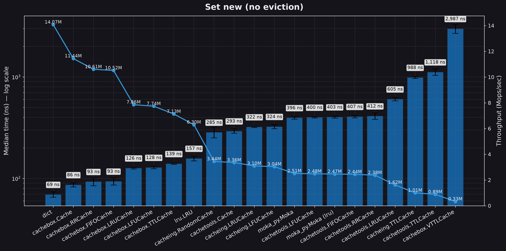
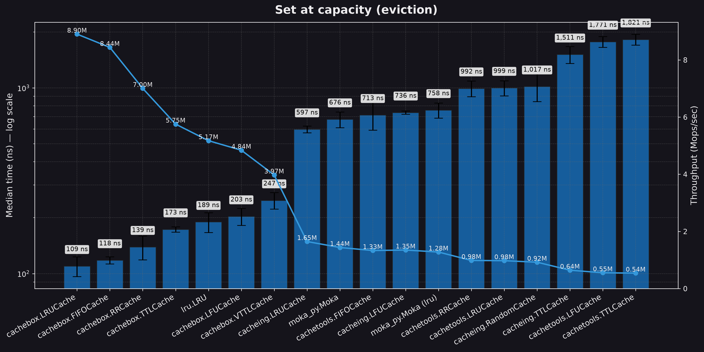
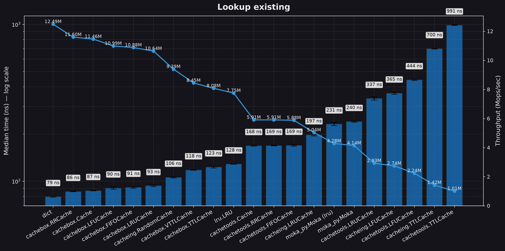
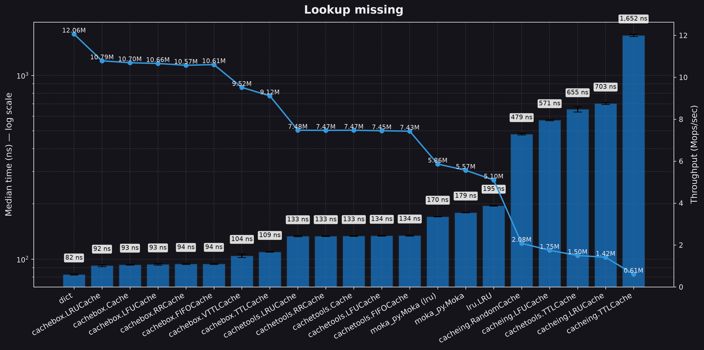
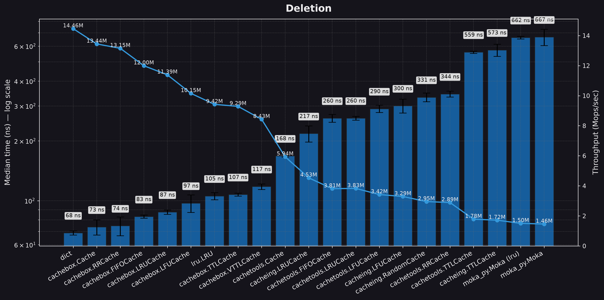
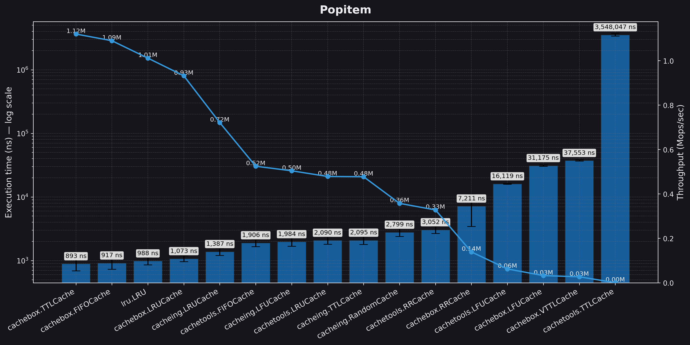
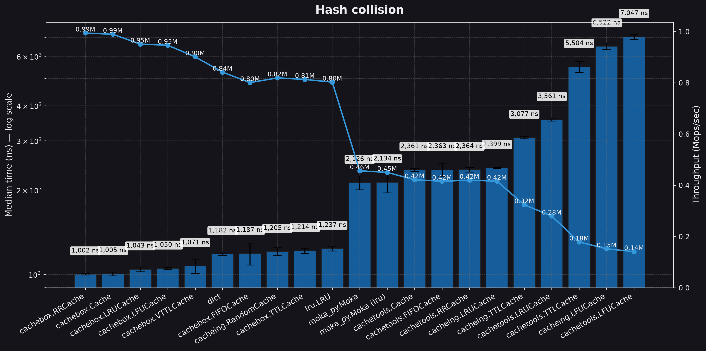
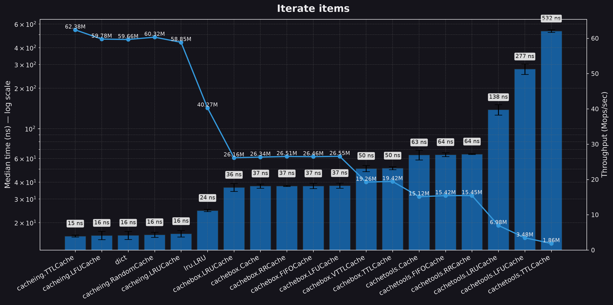

# Caching libraries Benchmarks

According to my new library [cachebox](https://github.com/awolverp/cachebox), I decided to benchmark caching libraries
which are I know, to show the power of [cachebox](https://github.com/awolverp/cachebox) ...

If you know other library, tell me to add it to this page.


> [!NOTE]\
> The `cacheing.VTTLCache` class was excluded from the benchmark because assigning a key raises `TypeError`.

## Methodology

Times are **from Python**: each sample is a calibrated inner loop around a single API call (`set` / `get` / `delete` / `popitem`, or one entry of an `items()` iteration). Setup and teardown are not timed. GC is collected before each sample and disabled during the timed region.

Reported values are the **median** ns/op (tables ranked by median), plus mean, stdev, MAD, ops/sec, sample count, and coefficient of variation. Outliers are **not** dropped. A result is flagged when CV > 10% or max > 1.5× mean.

All implementations use the same working set (`maxsize = 4096`, integer keys/values). TTL caches are constructed with a 3600s TTL so nothing expires during a sample. `dict`, `cachebox.Cache`, and `cachetools.Cache` have no eviction policy and are skipped on eviction cases.

| Case | What is measured |
| --- | --- |
| Set new (no eviction) | Insert keys that are not present and do not evict (cache ~25% full). |
| Set at capacity (eviction) | Insert new keys into a cache already at maxsize. |
| Lookup existing | `get` of a present key (LRU/LFU recency/frequency updates included). |
| Lookup missing | `get` of a missing key. |
| Deletion | Delete present keys (one delete per populated key, then a new cache). |
| Popitem | `popitem()` on a cache filled to maxsize. |
| Hash collision | `get` of keys whose `hash()` is always 42. |
| Iterate items | `for k, v in cache.items()` over a cache filled to maxsize; time is per entry. |

moka-py is a concurrent Rust cache measured **single-threaded** like the others.

## 🖥️ System Information

- **Platform**: Linux-7.2.11-arch1-1-x86_64-with-glibc2.44
- **Python**: 3.14.8
- **Processor**: 11th Gen Intel(R) Core(TM) i3-1115G4 @ 3.00GHz
- **Timer**: resolution 263.0 ns, overhead 42.0 ns
- **Run**: min-time 100 ms/sample, warmup 1, samples 25, isolated=no, fast=no, pin-cpu=off, nice=False
- **Hash seed**: unset (isolated workers use 0 except the collision case)
- **GC**: disabled during the timed loop; collected before each sample
- **Threading**: single-threaded (including moka-py)
- **Libraries**:
  - cachebox: 6.2.9
  - cachetools: 7.2.7
  - cacheing: 0.1.1
  - lru-dict: 1.4.1
  - moka-py: 0.5.0
  - matplotlib: 3.11.2
  - matplotx: 0.3.10

## 📊 Set new (no eviction)

Insert keys that do not exist and do not trigger eviction. Cache is pre-filled to 25% of maxsize.



- **Range**: 16.7× between fastest and slowest (median)
- **Best**: dict (66 ns, 14.9M ops/sec)

| Implementation | Median (ns) | Mean (ns) | Stdev | MAD | Ops/sec | Samples | CV |
| :---: | ---: | ---: | ---: | ---: | ---: | ---: | ---: |
| dict | 66.0 | 67.2 | 3.7 | 0.5 | 14.9M | 25 | 5.6% |
| cachebox.Cache | 99.7 | 100.7 | 5.1 | 1.9 | 9.9M | 200 | 5.0% |
| cachebox.RRCache | 108.7 | 109.2 | 3.7 | 2.0 | 9.2M | 200 | 3.3% |
| cachebox.FIFOCache | 112.2 | 113.1 | 5.2 | 1.7 | 8.8M | 200 | 4.6% |
| cachebox.LRUCache | 134.6 | 136.0 | 7.6 | 2.0 | 7.4M | 200 | 5.6% |
| cachebox.LFUCache | 136.3 | 136.8 | 5.8 | 1.8 | 7.3M | 200 | 4.2% |
| lru.LRU | 161.0 | 162.1 | 7.5 | 2.1 | 6.2M | 200 | 4.6% |
| cachebox.TTLCache | 162.0 | 163.0 | 5.6 | 2.2 | 6.1M | 200 | 3.5% |
| cachebox.VTTLCache | 168.4 | 170.7 | 10.1 | 2.3 | 5.9M | 200 | 5.9% |
| cachetools.Cache | 198.2 | 199.1 | 6.6 | 2.9 | 5.0M | 200 | 3.3% |
| cacheing.RandomCache | 297.3 | 300.7 | 12.1 | 3.5 | 3.3M | 200 | 4.0% |
| cachetools.LFUCache | 307.3 | 308.6 | 7.8 | 5.0 | 3.2M | 200 | 2.5% |
| cachetools.FIFOCache | 308.2 | 309.8 | 8.7 | 4.0 | 3.2M | 200 | 2.8% |
| cachetools.RRCache | 315.1 | 320.8 | 33.3 | 5.0 | 3.1M | 200 | 10.4% |
| cacheing.LRUCache | 334.0 | 336.7 | 11.6 | 3.6 | 3.0M | 200 | 3.4% |
| cacheing.LFUCache | 337.4 | 340.9 | 13.4 | 4.9 | 2.9M | 200 | 3.9% |
| moka_py.Moka | 402.0 | 403.2 | 10.4 | 4.9 | 2.5M | 200 | 2.6% |
| moka_py.Moka (lru) | 416.0 | 417.4 | 11.3 | 6.1 | 2.4M | 200 | 2.7% |
| cachetools.LRUCache | 510.5 | 512.9 | 10.1 | 5.7 | 1.9M | 200 | 2.0% |
| cachetools.TTLCache | 756.4 | 783.4 | 99.4 | 6.5 | 1.3M | 200 | 12.7% |
| cacheing.TTLCache | 1,102.9 | 1,122.8 | 68.6 | 12.7 | 0.9M | 200 | 6.1% |

## 📊 Set at capacity (eviction)

Insert new keys into a cache already at maxsize so each set evicts an entry.



- **Range**: 16.6× between fastest and slowest (median)
- **Best**: cachebox.LRUCache (110 ns, 8.9M ops/sec)

| Implementation | Median (ns) | Mean (ns) | Stdev | MAD | Ops/sec | Samples | CV |
| :---: | ---: | ---: | ---: | ---: | ---: | ---: | ---: |
| cachebox.LRUCache | 109.8 | 112.3 | 13.3 | 3.0 | 8.9M | 200 | 11.8% |
| cachebox.FIFOCache | 118.0 | 118.5 | 5.1 | 1.1 | 8.4M | 200 | 4.3% |
| cachebox.RRCache | 139.1 | 142.8 | 20.4 | 2.4 | 7.0M | 200 | 14.3% |
| cachebox.TTLCache | 173.0 | 173.8 | 5.8 | 2.4 | 5.8M | 200 | 3.3% |
| lru.LRU | 189.6 | 193.2 | 23.2 | 2.5 | 5.2M | 200 | 12.0% |
| cachebox.LFUCache | 203.3 | 206.6 | 21.2 | 3.8 | 4.8M | 200 | 10.3% |
| cachebox.VTTLCache | 247.9 | 251.6 | 25.3 | 4.8 | 4.0M | 200 | 10.0% |
| cacheing.LRUCache | 597.6 | 607.4 | 24.7 | 5.3 | 1.6M | 200 | 4.1% |
| moka_py.Moka | 676.4 | 695.5 | 66.2 | 7.1 | 1.4M | 163 | 9.5% |
| cachetools.FIFOCache | 713.8 | 750.9 | 121.7 | 25.5 | 1.3M | 200 | 16.2% |
| cacheing.LFUCache | 736.2 | 741.2 | 15.4 | 3.4 | 1.3M | 108 | 2.1% |
| moka_py.Moka (lru) | 758.4 | 782.1 | 70.4 | 7.8 | 1.3M | 191 | 9.0% |
| cachetools.RRCache | 992.9 | 1,015.7 | 96.0 | 8.1 | 1.0M | 89 | 9.5% |
| cachetools.LRUCache | 999.6 | 1,024.2 | 93.7 | 13.3 | 1.0M | 151 | 9.1% |
| cacheing.RandomCache | 1,017.1 | 1,083.7 | 173.1 | 10.9 | 0.9M | 143 | 16.0% |
| cacheing.TTLCache | 1,511.1 | 1,554.2 | 156.9 | 11.4 | 0.6M | 125 | 10.1% |
| cachetools.LFUCache | 1,771.5 | 1,807.1 | 117.0 | 6.2 | 0.6M | 194 | 6.5% |
| cachetools.TTLCache | 1,821.3 | 1,849.2 | 121.6 | 20.8 | 0.5M | 107 | 6.6% |

Skipped: `dict` (no eviction policy), `cachebox.Cache` (no eviction policy), `cachetools.Cache` (no eviction policy)

## 📊 Lookup existing

Look up keys that are in the cache. LRU/LFU recency or frequency updates are part of the API cost.



- **Range**: 13.6× between fastest and slowest (median)
- **Best**: dict (79 ns, 12.2M ops/sec)

| Implementation | Median (ns) | Mean (ns) | Stdev | MAD | Ops/sec | Samples | CV |
| :---: | ---: | ---: | ---: | ---: | ---: | ---: | ---: |
| dict | 78.7 | 82.1 | 9.9 | 0.5 | 12.2M | 25 | 12.1% |
| cachebox.Cache | 93.2 | 93.2 | 0.6 | 0.3 | 10.7M | 25 | 0.7% |
| cachebox.RRCache | 93.5 | 93.5 | 0.6 | 0.3 | 10.7M | 25 | 0.6% |
| cachebox.FIFOCache | 95.7 | 95.5 | 0.6 | 0.3 | 10.5M | 25 | 0.6% |
| cachebox.LFUCache | 96.5 | 96.6 | 0.7 | 0.6 | 10.3M | 25 | 0.7% |
| cachebox.LRUCache | 99.7 | 99.8 | 0.5 | 0.5 | 10.0M | 25 | 0.5% |
| cacheing.RandomCache | 109.6 | 109.9 | 1.5 | 0.4 | 9.1M | 25 | 1.4% |
| cachebox.VTTLCache | 127.3 | 127.4 | 0.6 | 0.5 | 7.9M | 25 | 0.4% |
| cachebox.TTLCache | 128.5 | 128.5 | 0.5 | 0.5 | 7.8M | 25 | 0.4% |
| lru.LRU | 135.4 | 138.4 | 15.4 | 0.1 | 7.2M | 25 | 11.1% |
| cachetools.Cache | 171.7 | 171.8 | 0.4 | 0.2 | 5.8M | 25 | 0.2% |
| cachetools.RRCache | 173.1 | 173.1 | 0.4 | 0.4 | 5.8M | 25 | 0.3% |
| cachetools.FIFOCache | 173.2 | 173.3 | 0.7 | 0.3 | 5.8M | 25 | 0.4% |
| cacheing.LRUCache | 201.0 | 201.2 | 1.3 | 0.6 | 5.0M | 25 | 0.6% |
| moka_py.Moka (lru) | 237.3 | 237.7 | 1.1 | 0.3 | 4.2M | 25 | 0.4% |
| moka_py.Moka | 246.0 | 246.1 | 0.9 | 0.5 | 4.1M | 25 | 0.4% |
| cachetools.LRUCache | 262.7 | 262.7 | 0.5 | 0.3 | 3.8M | 25 | 0.2% |
| cacheing.LFUCache | 372.3 | 370.7 | 5.8 | 2.7 | 2.7M | 25 | 1.6% |
| cachetools.LFUCache | 417.1 | 420.4 | 11.0 | 1.1 | 2.4M | 25 | 2.6% |
| cacheing.TTLCache | 786.2 | 787.6 | 6.3 | 1.6 | 1.3M | 25 | 0.8% |
| cachetools.TTLCache | 1,068.9 | 1,078.2 | 45.3 | 4.5 | 0.9M | 25 | 4.2% |

## 📊 Lookup missing

Look up keys that are not in a populated cache (mapping.get with default None).



- **Range**: 20.0× between fastest and slowest (median)
- **Best**: dict (83 ns, 12.1M ops/sec)

| Implementation | Median (ns) | Mean (ns) | Stdev | MAD | Ops/sec | Samples | CV |
| :---: | ---: | ---: | ---: | ---: | ---: | ---: | ---: |
| dict | 82.7 | 82.9 | 0.6 | 0.3 | 12.1M | 25 | 0.7% |
| cachebox.LRUCache | 92.4 | 92.7 | 1.2 | 0.7 | 10.8M | 25 | 1.3% |
| cachebox.Cache | 93.5 | 93.5 | 0.5 | 0.4 | 10.7M | 25 | 0.5% |
| cachebox.LFUCache | 93.9 | 93.8 | 0.9 | 0.8 | 10.7M | 25 | 1.0% |
| cachebox.RRCache | 94.4 | 94.6 | 0.8 | 0.5 | 10.6M | 25 | 0.8% |
| cachebox.FIFOCache | 94.5 | 94.3 | 0.8 | 0.6 | 10.6M | 25 | 0.8% |
| cachebox.VTTLCache | 104.4 | 105.1 | 2.4 | 0.6 | 9.5M | 25 | 2.3% |
| cachebox.TTLCache | 109.7 | 109.7 | 0.4 | 0.3 | 9.1M | 25 | 0.4% |
| cachetools.LRUCache | 133.5 | 133.8 | 1.0 | 0.4 | 7.5M | 25 | 0.8% |
| cachetools.RRCache | 133.7 | 133.9 | 0.8 | 0.2 | 7.5M | 25 | 0.6% |
| cachetools.Cache | 133.9 | 133.8 | 0.6 | 0.5 | 7.5M | 25 | 0.4% |
| cachetools.LFUCache | 134.3 | 134.2 | 0.6 | 0.3 | 7.5M | 25 | 0.4% |
| cachetools.FIFOCache | 134.7 | 134.6 | 0.9 | 0.9 | 7.4M | 25 | 0.7% |
| moka_py.Moka (lru) | 170.6 | 170.6 | 0.5 | 0.4 | 5.9M | 25 | 0.3% |
| moka_py.Moka | 179.7 | 179.7 | 0.4 | 0.3 | 5.6M | 25 | 0.2% |
| lru.LRU | 195.8 | 196.0 | 1.0 | 0.4 | 5.1M | 25 | 0.5% |
| cacheing.RandomCache | 480.0 | 480.2 | 5.6 | 4.2 | 2.1M | 25 | 1.2% |
| cacheing.LFUCache | 571.6 | 572.4 | 4.6 | 1.4 | 1.7M | 25 | 0.8% |
| cachetools.TTLCache | 655.5 | 666.7 | 22.3 | 3.1 | 1.5M | 25 | 3.3% |
| cacheing.LRUCache | 703.7 | 706.2 | 8.2 | 2.0 | 1.4M | 25 | 1.2% |
| cacheing.TTLCache | 1,652.5 | 1,645.5 | 25.7 | 17.9 | 0.6M | 25 | 1.6% |

## 📊 Deletion

Delete keys that exist. Each sample populates maxsize entries and deletes them once.



- **Range**: 10.0× between fastest and slowest (median)
- **Best**: dict (71 ns, 14.0M ops/sec)

| Implementation | Median (ns) | Mean (ns) | Stdev | MAD | Ops/sec | Samples | CV |
| :---: | ---: | ---: | ---: | ---: | ---: | ---: | ---: |
| dict | 71.1 | 71.3 | 1.8 | 1.1 | 14.0M | 200 | 2.5% |
| cachebox.Cache | 93.7 | 94.1 | 2.6 | 1.5 | 10.6M | 200 | 2.8% |
| cachebox.FIFOCache | 94.5 | 94.9 | 3.8 | 1.4 | 10.5M | 200 | 4.0% |
| cachebox.RRCache | 96.8 | 97.4 | 6.5 | 1.6 | 10.3M | 200 | 6.7% |
| cachebox.LRUCache | 106.1 | 106.8 | 5.1 | 2.3 | 9.4M | 200 | 4.8% |
| lru.LRU | 108.2 | 109.4 | 7.1 | 2.2 | 9.1M | 200 | 6.4% |
| cachebox.TTLCache | 124.8 | 127.0 | 12.0 | 2.3 | 7.9M | 200 | 9.4% |
| cachetools.Cache | 146.5 | 146.8 | 3.1 | 2.0 | 6.8M | 200 | 2.1% |
| cachebox.LFUCache | 180.3 | 182.7 | 18.4 | 2.8 | 5.5M | 200 | 10.0% |
| cachebox.VTTLCache | 210.2 | 212.2 | 11.8 | 4.1 | 4.7M | 200 | 5.6% |
| cacheing.LRUCache | 230.2 | 243.6 | 47.9 | 4.8 | 4.1M | 200 | 19.6% |
| cachetools.FIFOCache | 239.2 | 253.0 | 38.3 | 6.0 | 4.0M | 200 | 15.1% |
| cachetools.LRUCache | 240.9 | 257.1 | 39.5 | 6.9 | 3.9M | 200 | 15.4% |
| cachetools.LFUCache | 273.6 | 281.2 | 34.6 | 6.3 | 3.6M | 200 | 12.3% |
| cachetools.RRCache | 334.9 | 342.1 | 26.8 | 7.6 | 2.9M | 200 | 7.8% |
| cacheing.LFUCache | 339.7 | 370.4 | 75.8 | 26.4 | 2.7M | 200 | 20.5% |
| cacheing.RandomCache | 368.8 | 397.0 | 71.2 | 23.1 | 2.5M | 200 | 17.9% |
| cachetools.TTLCache | 631.6 | 603.8 | 44.8 | 19.1 | 1.7M | 83 | 7.4% |
| moka_py.Moka | 682.3 | 688.9 | 21.9 | 5.2 | 1.5M | 144 | 3.2% |
| moka_py.Moka (lru) | 684.9 | 686.1 | 12.2 | 4.1 | 1.5M | 127 | 1.8% |
| cacheing.TTLCache | 710.4 | 721.6 | 63.1 | 7.7 | 1.4M | 200 | 8.7% |

## 📊 Popitem

Call popitem() on a cache filled to maxsize (the eviction primitive).



- **Range**: 13.1× between fastest and slowest (median)
- **Best**: cachebox.FIFOCache (102 ns, 9.8M ops/sec)

| Implementation | Median (ns) | Mean (ns) | Stdev | MAD | Ops/sec | Samples | CV |
| :---: | ---: | ---: | ---: | ---: | ---: | ---: | ---: |
| cachebox.FIFOCache | 102.0 | 101.7 | 3.1 | 2.1 | 9.8M | 200 | 3.0% |
| cachebox.TTLCache | 108.1 | 109.1 | 5.2 | 2.0 | 9.2M | 200 | 4.8% |
| cachebox.LRUCache | 110.9 | 112.2 | 7.3 | 2.4 | 8.9M | 200 | 6.5% |
| lru.LRU | 137.0 | 137.8 | 6.9 | 2.1 | 7.3M | 200 | 5.0% |
| cachebox.RRCache | 148.9 | 152.0 | 12.1 | 4.9 | 6.6M | 200 | 8.0% |
| cachebox.LFUCache | 179.9 | 180.2 | 6.7 | 3.3 | 5.5M | 200 | 3.7% |
| cachebox.VTTLCache | 188.3 | 190.0 | 9.1 | 3.8 | 5.3M | 200 | 4.8% |
| cacheing.LRUCache | 242.7 | 246.0 | 12.2 | 5.4 | 4.1M | 200 | 5.0% |
| cacheing.TTLCache | 357.0 | 364.0 | 24.0 | 4.3 | 2.7M | 200 | 6.6% |
| cacheing.LFUCache | 358.5 | 364.1 | 16.6 | 7.1 | 2.7M | 200 | 4.6% |
| cachetools.FIFOCache | 447.0 | 447.5 | 50.8 | 41.3 | 2.2M | 200 | 11.3% |
| cachetools.LRUCache | 453.6 | 447.3 | 43.0 | 35.1 | 2.2M | 200 | 9.6% |
| cachetools.RRCache | 645.3 | 658.3 | 40.3 | 7.1 | 1.5M | 145 | 6.1% |
| cacheing.RandomCache | 657.7 | 683.1 | 70.2 | 11.4 | 1.5M | 181 | 10.3% |
| cachetools.TTLCache | 1,037.8 | 1,095.1 | 169.1 | 9.5 | 0.9M | 162 | 15.4% |
| cachetools.LFUCache | 1,333.8 | 1,344.9 | 33.4 | 7.6 | 0.7M | 200 | 2.5% |

Skipped: `dict` (no eviction policy), `cachebox.Cache` (no eviction policy), `cachetools.Cache` (no eviction policy), `moka_py.Moka` (no popitem), `moka_py.Moka (lru)` (no popitem)

## 📊 Hash collision

Look up keys that all hash to the same value (hash() == 42).



- **Range**: 7.0× between fastest and slowest (median)
- **Best**: cachebox.RRCache (1002 ns, 1.0M ops/sec)

| Implementation | Median (ns) | Mean (ns) | Stdev | MAD | Ops/sec | Samples | CV |
| :---: | ---: | ---: | ---: | ---: | ---: | ---: | ---: |
| cachebox.RRCache | 1,002.3 | 1,005.8 | 6.7 | 2.6 | 1.0M | 25 | 0.7% |
| cachebox.Cache | 1,005.1 | 1,010.6 | 15.3 | 2.1 | 1.0M | 25 | 1.5% |
| cachebox.LRUCache | 1,043.5 | 1,051.4 | 20.7 | 3.5 | 1.0M | 25 | 2.0% |
| cachebox.LFUCache | 1,050.8 | 1,056.5 | 8.9 | 2.9 | 0.9M | 25 | 0.8% |
| cachebox.VTTLCache | 1,071.5 | 1,109.4 | 63.7 | 1.3 | 0.9M | 25 | 5.7% |
| dict | 1,182.1 | 1,188.2 | 11.4 | 1.1 | 0.8M | 25 | 1.0% |
| cachebox.FIFOCache | 1,187.3 | 1,248.8 | 106.6 | 1.9 | 0.8M | 25 | 8.5% |
| cacheing.RandomCache | 1,206.0 | 1,220.7 | 39.7 | 1.0 | 0.8M | 25 | 3.3% |
| cachebox.TTLCache | 1,214.9 | 1,229.7 | 26.3 | 2.4 | 0.8M | 25 | 2.1% |
| lru.LRU | 1,237.1 | 1,245.8 | 25.1 | 0.8 | 0.8M | 25 | 2.0% |
| moka_py.Moka | 2,126.2 | 2,190.6 | 121.8 | 5.7 | 0.5M | 25 | 5.6% |
| moka_py.Moka (lru) | 2,134.3 | 2,220.1 | 180.0 | 3.8 | 0.5M | 25 | 8.1% |
| cachetools.Cache | 2,361.1 | 2,371.6 | 28.8 | 1.0 | 0.4M | 25 | 1.2% |
| cachetools.FIFOCache | 2,364.0 | 2,405.1 | 120.9 | 1.3 | 0.4M | 25 | 5.0% |
| cachetools.RRCache | 2,364.3 | 2,383.1 | 47.0 | 2.2 | 0.4M | 25 | 2.0% |
| cacheing.LRUCache | 2,399.3 | 2,403.2 | 11.7 | 0.7 | 0.4M | 25 | 0.5% |
| cacheing.TTLCache | 3,077.3 | 3,086.9 | 25.7 | 5.7 | 0.3M | 25 | 0.8% |
| cachetools.LRUCache | 3,561.1 | 3,573.3 | 32.1 | 1.4 | 0.3M | 25 | 0.9% |
| cachetools.TTLCache | 5,504.6 | 5,598.0 | 257.3 | 8.6 | 0.2M | 25 | 4.6% |
| cacheing.LFUCache | 6,522.9 | 6,575.1 | 175.6 | 16.2 | 0.2M | 25 | 2.7% |
| cachetools.LFUCache | 7,047.8 | 7,098.0 | 150.3 | 2.7 | 0.1M | 25 | 2.1% |

## 📊 Iterate items

Iterate `cache.items()` over a cache filled to maxsize. Time is per entry; creating the iterator is included in the timing.



- **Range**: 33.5× between fastest and slowest (median)
- **Best**: cacheing.TTLCache (16 ns, 62.4M ops/sec)

| Implementation | Median (ns) | Mean (ns) | Stdev | MAD | Ops/sec | Samples | CV |
| :---: | ---: | ---: | ---: | ---: | ---: | ---: | ---: |
| cacheing.TTLCache | 15.9 | 16.0 | 0.3 | 0.1 | 62.4M | 25 | 1.7% |
| cacheing.LFUCache | 16.1 | 16.7 | 1.1 | 0.1 | 59.8M | 25 | 6.7% |
| dict | 16.1 | 16.8 | 1.1 | 0.1 | 59.7M | 25 | 6.7% |
| cacheing.RandomCache | 16.3 | 16.6 | 0.7 | 0.1 | 60.3M | 25 | 4.3% |
| cacheing.LRUCache | 16.6 | 17.0 | 0.9 | 0.1 | 58.9M | 25 | 5.5% |
| lru.LRU | 24.7 | 24.8 | 0.5 | 0.1 | 40.3M | 25 | 1.9% |
| cachebox.LRUCache | 36.7 | 38.2 | 2.5 | 0.2 | 26.2M | 25 | 6.6% |
| cachebox.Cache | 37.5 | 38.0 | 1.4 | 0.1 | 26.3M | 25 | 3.6% |
| cachebox.RRCache | 37.5 | 37.7 | 0.3 | 0.0 | 26.5M | 25 | 0.8% |
| cachebox.FIFOCache | 37.6 | 37.8 | 1.7 | 0.2 | 26.5M | 25 | 4.5% |
| cachebox.LFUCache | 37.8 | 37.7 | 1.7 | 0.9 | 26.6M | 25 | 4.4% |
| cachebox.VTTLCache | 50.7 | 51.9 | 2.6 | 0.1 | 19.3M | 25 | 5.1% |
| cachebox.TTLCache | 50.9 | 51.5 | 1.3 | 0.2 | 19.4M | 25 | 2.5% |
| cachetools.Cache | 63.8 | 66.1 | 5.2 | 0.3 | 15.1M | 25 | 7.9% |
| cachetools.FIFOCache | 64.2 | 64.8 | 2.1 | 0.2 | 15.4M | 25 | 3.3% |
| cachetools.RRCache | 64.8 | 64.7 | 0.4 | 0.1 | 15.4M | 25 | 0.7% |
| cachetools.LRUCache | 138.5 | 143.3 | 12.4 | 0.3 | 7.0M | 25 | 8.7% |
| cachetools.LFUCache | 277.9 | 287.7 | 24.5 | 2.7 | 3.5M | 25 | 8.5% |
| cachetools.TTLCache | 532.3 | 536.8 | 12.0 | 0.6 | 1.9M | 25 | 2.2% |

Skipped: `moka_py.Moka` (no iteration API), `moka_py.Moka (lru)` (no iteration API)


## 🚀 Usage

### Prerequisites
```bash
uv sync
```

### Run Benchmarks
```bash
# All cases (in-process)
python -m cachebox_benchmark

# One or more cases
python -m cachebox_benchmark get_hit delete

# Faster iteration (not for published numbers)
python -m cachebox_benchmark --fast

# One subprocess per (case, implementation)
python -m cachebox_benchmark --isolated

# JSON + regenerate README from a previous run
python -m cachebox_benchmark --json results.json
python -m cachebox_benchmark --report-only results.json
```

Optional host knobs (off by default): `--pin-cpu 0`, `--nice`.

### Understanding Results

- **Median (ns)**: robust typical cost per operation; tables are sorted by this.
- **Mean / Stdev / MAD**: distribution; MAD is median absolute deviation.
- **Ops/sec**: throughput from the mean.
- **CV**: stdev / mean. High CV means the number is noisy, not that the library is “bad”.
